<h1 align="center">Hey there, I'm Mariam </h1>

<h3 align="center">I help companies create beautiful websites inside and out: well-designed and operational, with some clean code on the side.</h3>

<h2 align="center">🧰 Tech Skills</h2>

  

<h2 align="center">🎯 GitHub Stats</h2>

  

  

